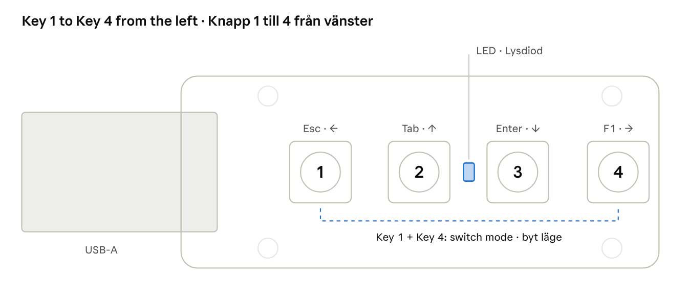

# RP2040 Mini Keyboard

Nov 14, 2026

## English

The RP2040 Mini Keyboard has four keys and two modes: Normal mode and Arrow mode. The LED shows which mode is active.

| Key | Normal mode, short press | Normal mode, long press | Arrow mode (LED on) |
| --- | --- | --- | --- |
| Key 1 | Esc | – | ← Left |
| Key 2 | Tab | – | ↑ Up |
| Key 3 | Enter | – | ↓ Down |
| Key 4 | F1 | Ctrl+Alt+Del | → Right |

### Getting started

Plug the keyboard into a USB-A port. No drivers are needed, the computer sees it as an ordinary keyboard. It starts in Normal mode with the LED off.

### Switching modes

Press Key 1 and Key 4 at the same time to switch between Normal mode and Arrow mode.

- LED on: Arrow mode
- LED off: Normal mode

### Short / Long press on Key 4

- Short press: F1
- Hold for about half a second: Ctrl+Alt+Del

A short press sends F1 when you release the key. Ctrl+Alt+Del is sent as soon as you have held Key 4 for half a second, while you are still holding it. The long press protects against pressing Ctrl+Alt+Del by mistake.

### Good to know

- Holding an arrow key repeats it, just like on a regular keyboard.
- What Ctrl+Alt+Del does depends on the operating system. On Windows it opens the security screen.

## Svenska

RP2040 Mini Keyboard har fyra knappar och två lägen: normalläge och pilläge. Lysdioden visar vilket läge som är aktivt.

| Knapp | Normalläge, kort tryck | Normalläge, långtryck | Pilläge (lysdioden lyser) |
| --- | --- | --- | --- |
| Knapp 1 | Esc | – | ← Vänster |
| Knapp 2 | Tab | – | ↑ Upp |
| Knapp 3 | Enter | – | ↓ Ner |
| Knapp 4 | F1 | Ctrl+Alt+Del | → Höger |

### Kom igång

Sätt tangentbordet i en USB-A-port. Inga drivrutiner behövs, datorn ser det som ett vanligt tangentbord. Det startar i normalläge med lysdioden släckt.

### Byta läge

Tryck på knapp 1 och knapp 4 samtidigt för att växla mellan normalläge och pilläge.

- Lysdioden lyser: pilläge
- Lysdioden är släckt: normalläge

### Kort / Långt tryck på knapp 4

- Kort tryck: F1
- Håll in i ungefär en halv sekund: Ctrl+Alt+Del

Ett kort tryck skickar F1 när du släpper knappen. Ctrl+Alt+Del skickas så fort du har hållit in knapp 4 en halv sekund, medan du fortfarande håller in den. Långtrycket skyddar mot att Ctrl+Alt+Del trycks av misstag.

### Bra att veta

- Om du håller in en piltangent upprepas den, precis som på ett vanligt tangentbord.
- Vad Ctrl+Alt+Del gör beror på operativsystemet. I Windows öppnas säkerhetsskärmen.
