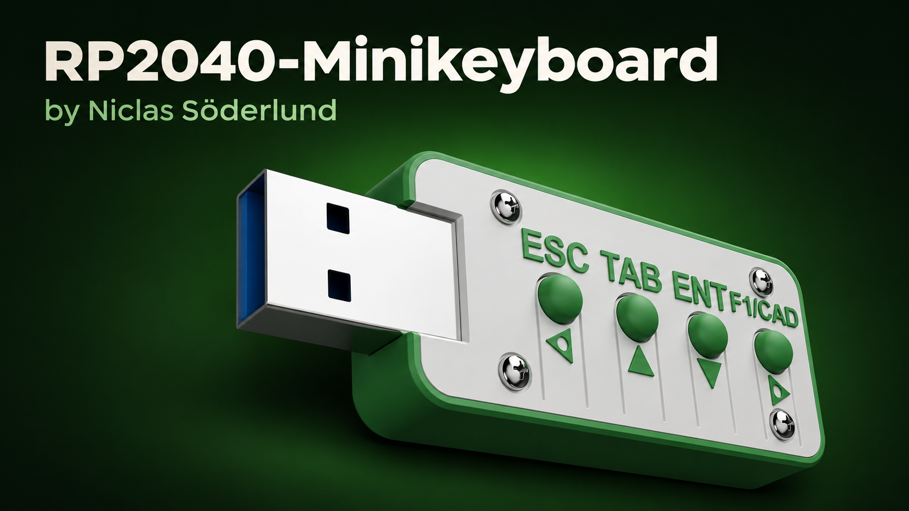

# RP2040 Mini Keyboard

A tiny four-key USB keyboard in a USB stick form factor, built around the RP2040 and running [QMK](https://qmk.fm/) firmware.



## Version

Version 3.0, for PCB Rev C (1792604589).

## How it works

The keyboard has four keys and two modes. The LED shows which mode is active.

| Key | Normal mode, short press | Normal mode, long press (0.5 s) | Arrow mode (LED on) |
| --- | --- | --- | --- |
| Key 1 | Esc | – | ← Left |
| Key 2 | Tab | – | ↑ Up |
| Key 3 | Enter | – | ↓ Down |
| Key 4 | F1 | Ctrl+Alt+Del | → Right |

- **Switch mode:** press Key 1 and Key 4 at the same time. Press them together again to go back.
- **Long press on Key 4:** Ctrl+Alt+Del is sent once the key has been held for 0.5 seconds. A short press sends F1.
- **Bootloader:** hold Key 1 while plugging the keyboard in. It shows up as the USB drive `RPI-RP2`, ready for new firmware.

The full user manual, in English and Swedish, is in [Manual](Manual/).

## Repository contents

| Folder | Contents |
| --- | --- |
| [Firmware/rppk](Firmware/rppk) | QMK keyboard definition and default keymap |
| [KiCad](KiCad) | Schematic, PCB layout, project file (KiCad 10) and 3D models |
| [Production](Production) | Gerber and drill files (zip), bill of materials (`bom.csv`) and component positions (`.pos`) |
| [3D](3D) | Print-ready enclosure for Bambu Lab (.3mf) |
| [Manual](Manual) | User manual (Markdown and PDF) |
| [Images](Images) | Product pictures |

## Hardware

| Part | Component |
| --- | --- |
| MCU | Raspberry Pi RP2040 |
| Flash | Winbond W25Q16JVUXIQ, 2 MB (USON-8, 2 × 3 mm) |
| Crystal | Abracon ABM8-272-T3, 12 MHz |
| 3.3 V regulator | Microchip MCP1700T-3302E/MAY |
| USB ESD protection | ST USBLC6-2SC6 |
| USB connector | Molex 48037-2200, USB-A plug |
| Keys | Alps SKHU tactile switches |
| LED | Rohm SML-D12V8WT86 |

GPIO assignment:

| Function | GPIO |
| --- | --- |
| Key 1 (Esc) | GP22 |
| Key 2 (Tab) | GP23 |
| Key 3 (Enter) | GP19 |
| Key 4 (F1 / Ctrl+Alt+Del) | GP20 |
| Arrow mode LED | GP18 |

## Building the firmware

The firmware is built with QMK. The steps below are for Linux; see the [QMK getting started guide](https://docs.qmk.fm/newbs_getting_started) for Windows and macOS.

### 1. Install QMK

On Debian or Ubuntu:

```bash
sudo apt install pipx git dos2unix
pipx install qmk
pipx ensurepath
```

Open a new terminal, then run:

```bash
qmk setup
```

Answer yes to the questions. This downloads QMK to `~/qmk_firmware` and installs the compiler.

### 2. Add the keyboard to QMK

From the root of this repository:

```bash
cp -r Firmware/rppk ~/qmk_firmware/keyboards/
```

### 3. Compile

```bash
qmk compile -kb rppk -km default
```

The finished firmware is saved as `~/qmk_firmware/rppk_default.uf2`.

## Flashing

1. Put the keyboard in bootloader mode:
   - A new board with empty flash starts in bootloader mode by itself.
   - Otherwise, hold Key 1 while plugging the keyboard in.
2. The keyboard shows up as a USB drive called `RPI-RP2`.
3. Copy `rppk_default.uf2` to the drive. The keyboard restarts on its own and is ready to use.

```bash
cp ~/qmk_firmware/rppk_default.uf2 /media/$USER/RPI-RP2/
```

## Customizing

All settings are in `Firmware/rppk/keymaps/default/`. Recompile and flash after a change.

| What to change | Where |
| --- | --- |
| Key functions, for example F1 to F2 | `keymap.c`: change `KC_F1` to `KC_F2` in `#define F1_CAD LT(0, KC_F1)` |
| Long press time (default 500 ms) | `config.h`: `TAPPING_TERM` |
| How close together Key 1 and Key 4 must be pressed (default 50 ms) | `config.h`: `COMBO_TERM` |

Key names are listed in the [QMK keycode reference](https://docs.qmk.fm/keycodes).

## License

| Part | License | File |
| --- | --- | --- |
| Firmware (`Firmware/`) | GPL-2.0-or-later | [Firmware/LICENSE](Firmware/LICENSE) |
| Hardware: KiCad files, Gerbers, enclosure (`KiCad/`, `Production/`, `3D/`) | CERN-OHL-S-2.0 | [LICENSE](LICENSE) |

If you make and distribute a modified version of the hardware, CERN-OHL-S-2.0 requires that you share your modified design files under the same licence.

## Author

Niclas Söderlund, Pickels 3D LAB, 2026
